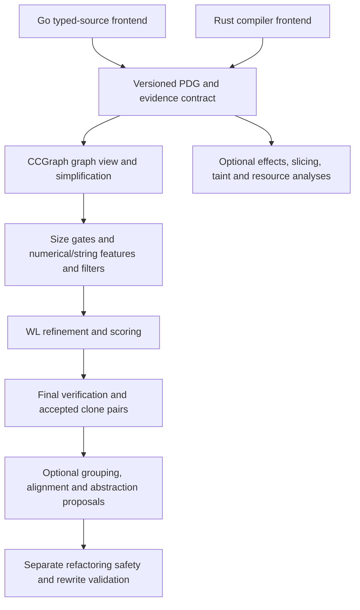

# CCGraph-first implementation and analysis unification plan

## Recommendations

**Implement a CCGraph-compatible clone-detection base in both `gstyle` and `rstyle`, backed by a shared, versioned PDG contract. Then build additional analyses around that foundation.** CCGraph is the first implementation milestone, not a side track in a general miner-unification project.

Start with a **focused source/reference gap audit of the PDG and CCGraph stages**, then specify stage contracts and shared conformance fixtures before implementation. Do not wait for an exhaustive inventory of every quality rule, detector or rewrite tool. Preserve that broader inventory as an extension backlog and dependency map. Do not start by merging repositories or standardizing their CLIs: identical commands or algorithm names do not establish identical analysis.

The common foundation is a **behavioral contract and interoperable graph representation**, not necessarily one shared runtime library. Go and Rust can implement it natively while using the same serialized graph fixtures, reference-profile decisions and expected intermediate results. Runtime sharing remains a later decision.

Go/Rust agreement establishes internal consistency, not agreement with CCGraph. Anchor the base in the paper and, if available, pinned original artifacts. Explicitly version interpretations where the paper is contradictory or incomplete. Keep abstraction-mining and retrieval extensions separate so they do not silently redefine the reference algorithm.

## Priority and layering

This section is the current direction. The broader family inventory below remains useful, but it no longer defines the critical path or the immediate completion gate.



This is a **target layering**, not a claim about current wiring. Do not force every extension through clone detection: dependence analyses can consume the PDG directly, and source-only style metrics can remain independent consumers of frontend facts.

### Layer 1: frontend facts and a reusable PDG

Define the interchange contract before extending the current expression graphs. At minimum, specify:

- Schema/profile versions, language/frontend identity and configuration, function identity, source spans, and graph-local node identity. Distinguish identity used for source navigation from equality used for matching.
- Node taxonomy and attributes sufficient to project the paper's declarations, assignments, controls, calls/state and other nodes. Preserve original language-specific kinds rather than force an undocumented equivalence.
- **Directed, typed data, control and execution dependencies**; define direction, multiplicity, operand positions where used, and how execution dependencies differ from simple source order. Do not treat the current omission of execution edges as paper fidelity.
- Declaration/use/reassignment and reaching-definition behavior; branch merges, loop-carried dependencies, returns, calls, parameters, closures/macros, and memory/alias boundaries. Each producer must state what is supported, approximated or unknown; sharing a schema does not prove accurate extraction.
- Function/interface metadata needed for all **nine numerical and three string features**. Specify reference counting and parameter serialization through explicit profile decisions, not inferred defaults.
- Completeness, provenance and unsupported/unknown evidence, distinct from a known zero count or an empty graph. Missing required evidence must produce a diagnostic or explicit non-conformant status, not silently pass as zero.
- Optional annotations for effects, ownership, calls/types and extension facts. These must not alter base WL labels or filters unless the versioned CCGraph profile explicitly requires them.
- Serialization, validation and deterministic comparison of graph structure and labels. Compare WL label-equivalence classes rather than require identical numeric hashes across languages.

Keep the extracted graph and source provenance available. Build a **separate, traceable CCGraph view** for simplification and paper-oriented labels/features; keep abstraction canonicalizations and effect-aware views separate. Every transformation must identify removed/collapsed nodes and edge handling. This avoids losing information needed by later analyses and prevents an extension from mutating the base detector's input.

This is a contract checklist, **not a final schema or a decision to implement full memory/interprocedural PDGs immediately**. The focused audit must distinguish fields required for the first supported CCGraph profile from capabilities deferred with explicit limitations. C/Java generator behavior is a reference comparison; Go/Rust adaptation must be documented rather than claimed to reproduce Frama-C or TinyPDG automatically.

### Layer 2: CCGraph base in both engines

The base boundary is `supported PDG + function metadata + versioned reference profile → accepted clone pairs + stage evidence`.

Implement and test these independently changeable stages in **both** engines:

1. Generation/adaptation and reference simplification.
2. The nine numerical and three string features, with declared units and serialization.
3. Minimum-size/scale gates and numerical/string filtering.
4. Initial labels, neighborhood encoding, equality-preserving compression and synchronous refinement under a declared policy.
5. Diameter/depth, iteration weights, label multiplicity and preliminary scoring.
6. Final verification and threshold comparisons.
7. Stable, deduplicated **pair output**, retaining accepted-pair evidence before optional grouping or UI filters.

Use an exhaustive pair-evaluation path over small graph fixtures as the initial conformance oracle for the selected profile. Candidate-retrieval LSH, AST bypass, neighborhood-WL replacement, abstraction-specific canonicalization, heuristic pair caps, connected grouping and abstraction ranking do **not** belong to the base profile. Exact optimizations may later share its contract if supported by equivalence tests; lossy retrieval must be separately named and measured against the exhaustive path.

The PDF does not uniquely define every stage. Phase one records competing readings; the specification milestone resolves or explicitly blocks each one using original artifacts where available, then names and versions the chosen interpretation. “Conforms to profile X” and “reproduces the original CCGraph tool” are different claims.

### Layer 3: optional consumers and extension profiles

After the base milestone, classify existing additional scopes by their dependency:

| Extension | Inputs/boundary | Separate acceptance evidence |
| --- | --- | --- |
| Clone grouping and inconsistent-clone analysis | Accepted pairs and graph/source evidence | Retain actual pair relations; a connected component is not a verified clique |
| Alignment, holes, templates and anti-unification | Clone pairs and/or an independently named mining path, plus a richer graph/AST view | Alignment and proposal quality; not base detector fidelity |
| Effect/ownership-aware proposals | PDG annotations and language-specific facts | Unknown handling and compatibility; not semantic-equivalence proof |
| Slicing/chopping, taint and resource obligations | PDG dependencies plus explicit call/memory/effect evidence | Their own soundness/completeness boundaries and fixtures |
| Signatures, parameter bundles and structural/API rules | Frontend facts and optional PDG/call graph | Their own thresholds, identities and ranking |
| Rewrite execution | Source mapping, a proposal, and additional safety preconditions | Compile/test/behavioral checks actually performed; a clone match alone never authorizes a safe rewrite |
| AST bypass, candidate LSH and alternative kernels | Explicit extension profile | Pair-set/quality/runtime comparisons against the base; no silent base-result changes |

Preserve existing engine behavior during migration; do not silently change defaults or remove independent detectors. The new base/profile boundary and any later CLI activation must be explicit and tested.

## Ordered milestones and acceptance gates

| Milestone | Work | Gate |
| --- | --- | --- |
| **M0 — focused audit (current phase one)** | Trace Go/Rust PDG producers and conversions, CCGraph-relevant stages, paper ambiguities, and extension contamination. Record current/absent behavior and fixture designs. | Source-backed readiness matrix, PDG gap ledger, and bounded coverage; no implementations or interpretation choices required |
| **M1 — contract and fixtures** | Specify/version PDG interchange and the first supported CCGraph profile; resolve or explicitly block paper decisions. Design reference expectations independently of either engine. | Graph validation/round-trip expectations and stage fixtures for all base stages, including unknown and boundary cases |
| **M2 — PDG producer conformance** | Adapt Go and Rust frontends, source mapping and serialization to the supported contract. | Each frontend passes extraction fixtures; missing evidence is visible; unsupported language cases are documented |
| **M3 — CCGraph in both engines** | Implement the full pair detector in Go and Rust, not just shared WL similarity. Use the same imported graph fixtures and selected reference profile. | Matching stage traces and accepted pairs under that profile; separate frontend-adaptation and original-tool-reproduction claims; baseline results unaffected by extension toggles |
| **M4 — extensions around the base** | Reconnect/group existing capabilities as optional consumers or named profiles, one scope at a time. | Each extension has its own contracts/tests and demonstrates that enabling it does not mutate base results |
| **M5 — scale and quality** | Validate exact optimizations, then benchmark optional approximate retrieval and detectors against labeled corpora. | Recorded configuration/corpus/revision and pair-level quality, runtime and memory; group-count gains alone are insufficient |

Implement incrementally after M1; do not require every conceivable PDG capability before testing a bounded supported profile. Within a milestone, the two engines may progress independently, but neither inherits correctness from the other.

## Initial inventory

This is a source-informed family map, **not yet an exhaustive, verified parity matrix**.

| Family | What to capture | Current picture |
| --- | --- | --- |
| Fact extraction | Function boundaries, statement/line counting, parameters, identities, calls, types, argument provenance | Go typed AST versus Rust HIR; necessarily language-specific implementations |
| Mutation and effects | Mutation targets, ownership/escape behavior, aliases, callee classification, unknown effects, transitive summaries | Both implement these, with materially different semantics and propagation |
| Style evaluation | Length, parameters, mutation budgets, density, additional rules, thresholds | Shared core concepts; Rust includes spacing, Go includes additional domain-oriented rules |
| Refactor planning | Call resolution, edit footprints, overlapping fix groups, ordering, pass-through parameters, parameter bundles | Both have implementations |
| Abstraction mining | Signature normalization/rarity, program dependence graphs (PDGs), Weisfeiler–Lehman (WL) similarity, pair selection, alignment, holes, clustering, candidate inference and scoring | Considerable overlap; Go includes explicit ports of Rust algorithms, with subsequent differences |
| Additional detection | Clone detection, API association rules, error-handling outliers, dependence clusters, slicing, taint, resource obligations, domain-model heuristics | A substantial additional surface in Go |
| Filtering and identity | Suppression, existing-abstraction recognition, deduplication, candidate IDs, reviewed-candidate matching, filtering order | Changes findings and belongs in algorithm contracts |
| Supporting algorithms | Complexity metrics, source rewriting, reduction, evaluation and statistical scoring | Inventory separately from the core analyzer |
| CCGraph base pipeline | PDG generation/simplification, characteristic features, filtering, WL matching, final verification and clone-pair output | First shared implementation target; current shared concepts and thresholds do not establish reproduction |

Useful source starting points:

- Go pattern orchestration: [gstyle/domain/patterns/report.go](gstyle/domain/patterns/report.go)
- Go quality algorithms: [gstyle/domain/quality/](gstyle/domain/quality/)
- Go extraction: [gstyle/adapters/goquality/](gstyle/adapters/goquality/) and [gstyle/adapters/gopatterns/](gstyle/adapters/gopatterns/)
- Rust style orchestration: [rstyle/crates/rstyle-core/src/lib.rs](rstyle/crates/rstyle-core/src/lib.rs)
- Rust mining orchestration: [rstyle/crates/rstyle-core/src/patterns_report.rs](rstyle/crates/rstyle-core/src/patterns_report.rs)
- Rust extraction: [rstyle/crates/rstyle-driver/src/](rstyle/crates/rstyle-driver/src/)

The Go pattern pipeline registers many detectors beyond signature/WL abstraction mining. A README-derived list would miss important functionality.

## 1. Catalog behavior, not just names

Give each algorithm or meaningful variant a stable ID, such as:

- `effects.transitive-summary`
- `patterns.wl-similarity`
- `patterns.pair-selection`
- `patterns.alignment`
- `patterns.cluster-construction`
- `refactor.closed-parameter-bundles`

For each entry, record:

| Field | Why it matters |
| --- | --- |
| Inputs and outputs | Establishes the actual contract |
| Procedure | Describes actual implementation behavior, not just a referenced paper |
| Defaults, thresholds and limits | Often the source of apparent algorithm disagreements |
| Unknown/failure behavior | Especially important for conservative static analysis |
| Ordering and tie-breaking | Determines reproducibility and sometimes which candidates survive |
| Source symbols and callers | Makes the inventory traceable |
| Tests and fixtures | Shows which claims have evidence |
| Go/Rust differences | Separates intended language differences from accidental drift |

**Split stages when they can disagree independently.** “WL mining” is too coarse: graph labeling, refinement, similarity, pair blocking, alignment, clustering and scoring are separate contracts.

Both projects have WL-based mining, but the inspected Go implementation includes weighted similarity and multiple-template clustering behavior that should not be assumed equivalent to Rust merely because filenames match.

## 2. Establish completeness with a two-way audit

### Entrypoints to implementations

Trace every analysis mode through its semantic pipeline:

```text
selection → extraction → transformations → analysis
          → scoring/planning → suppression/filtering → report
```

Record all reachable algorithms, including optional flags and configuration-dependent branches.

### Implementations to callers

Review every analysis-bearing module and classify it as:

- Production/default
- Production/opt-in
- Experimental
- Library-only
- Dormant or currently unsatisfiable
- Supporting tooling
- Non-analysis infrastructure

This catches algorithms that exist and have tests but never run through the normal pipeline.

**Keep implementation status and reachability separate.** The initial source investigation found a Go factory detector whose qualification predicate is currently unsatisfiable. Implemented and registered therefore do not necessarily mean capable of producing findings. Treat this observation as an audit lead to reverify against the cataloged revision.

### Fact lifecycle

For every important schema field, trace:

```text
producer → serialization/conversion → consumer
```

This catches missing plumbing, not just missing algorithms. The inspected Go report and fixer paths populate different mining inputs; comparing only their downstream miners would conceal that difference.

### Test index

Map tests back to catalog entries. Tests can reveal undocumented variants, negative guards, recursion limits and special cases.

Classify the evidence: a hand-built PDG unit test does not establish that the compiler frontend extracts that PDG correctly.

### Completeness criterion

For **M0**, every module, entrypoint, semantic switch, schema producer/converter/consumer and relevant test family on the PDG/CCGraph base path has a catalog entry or an explicit limitation. Include extension code that can change base inputs, retrieval or results. Classify other scopes as extension backlog, not as fully reviewed or excluded from the eventual union inventory.

Full-union inventory completion is a separate, later coverage claim. Record the audited repository revisions and any local modifications so completeness has a defined scope. Retain a source-file-to-catalog coverage checklist; do not declare completeness solely from a prose algorithm list.

## 3. Build a base-readiness matrix and an extension parity matrix

First compare **PDG/CCGraph reference stages → Go implementation → Rust implementation → missing producer/stage/evidence → fixture → milestone**. Missing Rust clone-detection stages are implementation gaps, not a reason to redefine the target as the intersection of existing miners.

For the extension backlog, use the **union** of both projects’ capabilities, not their intersection.

For every catalog entry, distinguish:

- Present in both and equivalent
- Present in both but divergent
- Go-only or Rust-only
- Intentionally language-specific
- Experimental/dormant
- Not yet verified

Then choose the target behavior explicitly. Neither implementation should automatically become the specification.

For mutation, Rust mutable-borrow evidence and Go alias/ownership evidence are not interchangeable. Unify the meaning of resulting facts while retaining language-specific extraction, and document cases where equivalent evidence is unavailable.

## 4. Make the specification executable

Use three test layers:

### Shared fact/graph fixtures

First feed identical serialized PDGs/function metadata to both implementations and compare simplified graphs, all features, gate decisions, per-round WL equivalence classes/counts, depth/weights, scores/denominators and accepted pairs independently of compiler frontends. Validate serialization, required fields and unsupported/unknown evidence. Later extend this layer to effects, alignment, clusters, scores and fix plans without changing base expectations.

### Frontend extraction fixtures

Verify that Go and Rust constructs produce the intended facts. Pair equivalent concepts where possible; keep language-specific cases explicit.

### End-to-end and metamorphic tests

Verify properties such as:

- Input order does not change results.
- Renaming locals does not change structural similarity.
- Moving source lines does not change semantic identity.
- Threshold equality behaves consistently.
- Cycles and summary limits retain the intended unknown evidence.
- Normalizers are idempotent where promised.

Agreement between implementations is useful but **not sufficient**: both can share the same bug. Fixtures also need independently specified expectations.

## 5. Implement and verify the CCGraph base

### Reference and evidence policy

Reference: Zou, Ban, Xue and Xu, *CCGraph: a PDG-based code clone detector with approximate graph matching*, ASE 2020, DOI `10.1145/3324884.3416541`.

- Local source: [ccgraph_paper.pdf](ccgraph_paper.pdf).
- PDF SHA-256: `abfd1f66cdac144cfd6a7e6626b0d9bbd302dc603b641afe23ab24e9dc4160c9`.
- References below use **1-based PDF page numbers**.
- Related compat discussions: [CCGraph fidelity (#3)](https://github.com/rstyled/compat/issues/3) and [architecture decision map (#6)](https://github.com/rstyled/compat/issues/6).

For each reference requirement, record the exact section/algorithm/equation and classify the evidence as **explicit paper requirement**, **reported experimental setting**, **conflicting/underspecified**, or **implementation decision**. Record Go and Rust behavior separately from the reference, with source symbols, fixture IDs and observed results.

Distinguish a **documented interpretation of the paper** from a **reproduction of the original implementation**. Locate and pin the original tool, graph generators, configurations and artifacts if available. If they are unavailable, label that limitation; do not claim original-tool equivalence from a locally written reference engine.

### Stage-level fidelity inventory

| Stage | Reference behavior to capture | Paper reference |
| --- | --- | --- |
| PDG generation | Function-level directed, node/edge-labeled graphs; control, data and execution dependencies. Experiments use Frama-C for C and TinyPDG for Java, imported through `.dot`. Record generator-specific semantics rather than assuming our expression graphs are equivalent. | pp. 3–4, §§2.1/3.1; p. 7, §4.1 |
| Simplification | Remove generated system/auxiliary nodes and incident edges; collapse called-function sub-PDGs to `Fun_Call` nodes. Resolve node taxonomy, boundaries and edge rewiring explicitly. | p. 5, §§3.2.1–3.2.2 |
| Characteristic features | Nine numerical fields: `NumOfCtrlEdges`, `NumOfExcEdges`, `NumOfDataEdges`, `NumOfDeclNodes`, `NumOfAssignNodes`, `NumOfCtrlNodes`, `NumOfStateNodes`, `NumOfOtherNodes`, `NumOfReference`. Three string fields: `ReturnPara`, `IntroPara`, `Name`. | p. 5, Table 1 |
| Size/scale and numerical filtering | Minimum-size and graph-scale gates; cosine comparison of numerical vectors. Reported settings include six source lines and numerical threshold 0.9, but size units and exact scale cutoff need clarification. | pp. 5–6, Algorithm 1/§3.3.1 |
| String filtering | Jaro–Winkler comparison of string features; reported rejection below 0.5. Specify input/output parameter serialization, field aggregation, matching window, prefix handling and empty-string behavior. | p. 6, §3.3.2 |
| WL matching | Grammar-category initial labels; sorted neighbor-label multisets plus the current label; comparable compressed labels. Depth is selected according to the smaller PDG diameter; iteration weight is `(h - n + 1) / h`. Specify label multiplicity, direction/edge handling, depth convention and score normalization. | pp. 3–4, §2.3; pp. 6–7, §3.4/Algorithm 2 |
| Final verification | Section 3.5 prints `sim(G1, G2) = k_WL^(h)(G1, G2) / min(|V1|, |V2|)` and accepts at `>= 0.9`. Preserve this separately from the preliminary union-based formula and Algorithm 2 score until their relationship is resolved. | p. 4, §2.4; p. 7, §3.5 |
| Results | Clone pairs, not abstraction proposals or transitive groups. Define self-pair exclusion, pair deduplication and ordering for our contract. | p. 5, Figure 4; p. 6, Algorithm 2 |

There is **no separate final exact subgraph-isomorphism verifier prescribed** by the paper. Do not add one and call it a CCGraph requirement. Approximate matching also does not prove behavioral equivalence or refactoring safety.

### Resolve paper ambiguities before claiming exactness

Track these as explicit decisions, supported by original artifacts where possible:

1. **Filter composition:** prose describes numerical filtering followed by string filtering. Algorithm 1 accepts on numerical success or otherwise string success, and its numerical/string threshold variable names are reversed relative to its input definitions. Keep the prose and literal-pseudocode interpretations distinguishable; do not silently choose AND or OR.
2. **Minimum size and scale:** Algorithm 1 describes a node-number threshold; §3.3.1 reports six source lines. A graph being ten times larger is an example, not a declared scale cutoff. Do not infer an exact `10x` setting from that sentence.
3. **Kernel and normalization:** the preliminary base kernel counts equal-label cross-graph node pairs, while Algorithm 2 uses `samelabel / total` with weighted accumulation. Multiset intersection, cross-product counting and one-to-one matching can disagree. Algorithm 2 does not show normalization by the weight sum; §2.4 uses a union denominator and §3.5 uses the smaller node count. Resolve iteration-zero inclusion, score range, denominators and strict versus inclusive threshold comparisons.
4. **Neighborhood encoding:** the graphs are directed and edge-labeled, but exact WL encoding of direction and dependency type is not stated. Record our deterministic encoding as a choice unless confirmed by original artifacts.
5. **Hashing and retrieval:** §3.4 calls neighborhood-label compression “local sensitive hashing,” but Algorithm 2 requires equal encodings if and only if the sequences are equal. It does not specify a random-hyperplane candidate index. Our LSH candidate retrieval is an extension whose recall must be measured independently.
6. **Feature interpretation:** Table 1 says “function state nodes,” while §3.3.1 discusses function-call nodes. Reference counting, parameter serialization, string-field aggregation and exact simplification rules are underspecified.

### Initial implementation gaps to verify

These are source-inspection leads, not runtime validation or a complete gap audit:

- [Go clone pipeline](gstyle/domain/patterns/ccgraph.go) uses a seven-element [characteristic vector](gstyle/domain/patterns/wl.go), function-name filtering, an AST-similarity bypass, LSH candidate retrieval and connected clone groups. These are not the paper's complete feature set or pair-output contract.
- Go and [Rust WL similarity](rstyle/crates/rstyle-core/src/wl.rs) use weighted histogram intersection normalized by the larger node count and weight sum. That does not directly implement the printed §3.5 verification formula.
- [Rust graph facts](rstyle/crates/rstyle-core/src/facts.rs) have data/control edges and explicitly omit execution-order edges. Audit Go extraction and both frontends' reassignment, reaching-definition, control and memory-dependence semantics against the selected reference generator behavior.
- [Go paper documentation](gstyle/docs/papers.md) currently labels CCGraph fidelity “Exact” and attributes seven-dimensional features plus LSH candidate clustering to the paper. Matching the three threshold values is not evidence for that claim. Reconcile these claims with the fidelity audit.
- Rust's abstraction-mining pipeline and Go's clone/abstraction extensions have different purposes. Compare the CCGraph-compatible pair detector separately from alignment, holes, clustering and refactor inference.

### Additional audit input: agent divergence reflection

Use [ccgraph-divergences.md](ccgraph-divergences.md) as a **historical claim ledger and discovery input**, not as an authoritative specification or verified benchmark report. Its opening “paper-exact” claim conflicts with the paper-grounded gaps above. Verify each claim against the audited revision, its production callers and the supplied paper.

| Reflection item | Phase-one inventory action |
| --- | --- |
| AST pre-filter/bypass | Record AST node multiset construction, Jaccard formula, 0.8 boundary, exactly which filters are bypassed, and library versus production-mode activation. `patterns.Run` currently calls the AST-enabled path; an opt-in library API does not establish that normal pattern analysis disables it. |
| Neighborhood WL | Inventory the per-node 1/2-hop neighborhoods, one-round refinement, aggregation, weighting and normalization as a distinct kernel variant. Verify wiring and compare accepted pair sets; more groups alone does not establish better recall. |
| Integer pair keys | Trace the current pair representation and any historical transition. The inspected `ccpairs.go` uses a word-based pair bitset; do not document the reflection's `int64` map as the current implementation. |
| Light WL instances | Compare retained state, reused characteristic vectors, diameter computation and all relevant consumers against full WL instances. A similarity of 1000 for one comparison does not prove general behavioral equivalence. |
| Clone-to-anti-unification bridge | Trace clone groups through alignment, template/holes, effect compatibility and parameterize proposals. Separate clone detection from abstraction inference and source-rewrite feasibility. |
| Effect bitflags | Inventory extraction, defaults/unknowns, labels, alignment holes and candidate filtering. Effect fields and extraction are present in the inspected tree; the reflection's branch/merge status requires independent revision evidence. Presence alone does not prove safe extraction. |

Record the reflection's timing, memory, group counts, PR numbers and merge statements as **reported historical claims** until their revisions, corpus, configuration, hardware, commands, raw artifacts and reproducibility are established. Distinguish group count, pair count, labeled recall and capability gain.

### Required conformance and reproduction checks

Implement a distinct **CCGraph-compatible base profile in both engines**, with the existing abstraction-mining behavior classified as an extension profile or independent consumer. Version reference interpretation decisions. Disable AST bypasses, candidate-index LSH, neighborhood-WL replacements, abstraction canonicalization, heuristic pair caps, clustering and abstraction scoring within the base profile; evaluate them separately. Retain base pair output and stage evidence even when a consumer later groups, suppresses or ranks results.

Use stage-level golden fixtures, not just final clone counts:

- Original and simplified node/edge sets; all nine numerical and three string features.
- Size/scale gates and cosine/Jaro–Winkler values, including fixtures that distinguish sequential AND from OR filtering.
- Per-round WL labels or label-equivalence classes, multiplicities, selected depth and weights. Include repeated-label graphs, unequal graph sizes, disconnected graphs and zero-diameter cases.
- Kernel, weighted score, verification denominator and acceptance as separate trace fields; test below, at and above 0.5/0.9, plus six-line boundary cases and graph containment.
- Final clone-pair sets before grouping. Include `A~B`, `B~C`, `A!~C` so a connected group cannot be mistaken for three verified pairs.
- Brute-force reference candidate evaluation versus optimized retrieval. Report missed reference pairs and recall tradeoffs; an approximate index is not behavior-preserving merely because it is deterministic.
- Paired Go/Rust examples for supported concepts, plus C/Java fixtures or original generator graphs where obtainable. Language adaptation is not the same claim as reproducing C/Java frontend output.

Reproduce the paper's formatting, renaming/type-changing, statement-reordering and control-substitution examples where available, but independently label expected results and include negative controls. Do not assume every statement reorder is safe.

Keep **algorithm fidelity**, **cross-language parity** and **benchmark quality** as separate results. The paper evaluates selected BigCloneBench functionalities rather than the entire benchmark, and its recall denominator uses a manually validated union of tool-reported clones. Document dataset subsets, labels, exclusions, toolchain/configuration and limitations when comparing precision, recall, runtime or scalability.

A CCGraph fidelity claim is complete only when each reference stage has a traceable contract and passing fixtures, ambiguities are resolved or explicitly blocked, and adaptations are labeled. Claims of original-implementation reproduction additionally require evidence against pinned original artifacts.

## Deliverables and scope

In milestone order, produce:

1. **Focused PDG/CCGraph algorithm catalog, fidelity/readiness matrix and gap ledger** with source/test traceability (M0).
2. **Versioned PDG interchange contract and CCGraph reference-profile decision record**, separating explicit paper requirements, chosen interpretations and language adaptations (M1).
3. **Shared graph/stage conformance corpus and frontend extraction fixtures**, followed by conforming PDG producers (M1–M2).
4. **A CCGraph clone-pair implementation in each engine**, with stage traces and clearly bounded fidelity/reproduction claims (M3).
5. **Extension dependency map, contracts and broader union parity inventory**, reconnecting additional scopes around the foundation without changing the base (M4).
6. **Optimization/retrieval and labeled-quality evidence** separate from reference conformance (M5).

A shared runtime library, repository merge and uniform CLI are not prerequisites for these deliverables.

Keep CLI parsing, TUI rendering, RPC and packaging in a low-priority appendix. Do not exclude behavior merely because it currently lives in a CLI module: selection, filtering order and conversion into analysis facts can change results.

## Phase-one execution prompt

Use [PHASE_ONE_INVENTORY_PROMPT.md](PHASE_ONE_INVENTORY_PROMPT.md) for the **M0 focused PDG/CCGraph audit**. It requires implementation-specific pseudocode, source/test traceability, a base-readiness/fidelity matrix, the reflection claim ledger, and an extension dependency/backlog map. Existing broader audit records remain evidence, not a reason to postpone the base milestone. Phase one documents current behavior and test gaps; it does not change algorithms, finalize a schema or select unresolved paper interpretations.

## Completion checklist

Treat this as a multi-milestone checklist, **not** a requirement that all extensions be exhausted before M0 or M3 can finish.

- [ ] Complete bounded M0 coverage of PDG producers/conversions and all CCGraph base stages in both engines, with absent stages explicit.
- [ ] Document the versioned PDG contract, unknown evidence, source provenance and separate graph views (M1).
- [ ] Validate both frontend producers against the supported PDG profile (M2).
- [ ] Implement and validate accepted clone-pair output in both engines, preserving stage evidence (M3).
- [ ] Demonstrate base-result isolation from extension annotations, transformations and toggles (M3–M4).
- [ ] Record audited repository revisions, local modifications and analysis entrypoints.
- [ ] Classify all analysis-bearing modules and explicit exclusions.
- [ ] Inventory registered rules/kinds, semantic switches, variants, defaults and limits.
- [ ] Trace required fact fields through producers, conversions and consumers.
- [ ] Map tests and identify evidence gaps.
- [ ] Describe each algorithm/variant with source-traceable, implementation-specific pseudocode.
- [ ] Reconcile every claim in the CCGraph divergence reflection against current source, paper evidence and available benchmark artifacts.
- [ ] Produce the union-based Go/Rust parity matrix.
- [ ] Decide target semantics and intentional language-specific exceptions.
- [ ] Add shared fact/graph fixtures and frontend fixtures for initial contracts.
- [ ] Automate conformance checks before implementation convergence.
- [ ] Inventory CCGraph stages with PDF page/section/equation references and classify evidence strength.
- [ ] Resolve or explicitly block paper ambiguities using pinned original artifacts where available.
- [ ] Produce a paper/reference-versus-Go-versus-Rust fidelity matrix, including graph semantics and final pair verification.
- [ ] Specify a CCGraph-compatible profile separately from abstraction-mining extensions.
- [ ] Add stage-level CCGraph golden fixtures and threshold/containment/negative-control cases.
- [ ] Measure optimized candidate retrieval against brute-force reference pairs.
- [ ] Reconcile unsupported “Exact” fidelity claims and document reproduction/evaluation limits.

## Evidence status

Initial observations come from read-only source and test inspection, not an exhaustive audit. The CCGraph track additionally uses direct text extraction from the supplied PDF, with paper-page references and a recorded checksum. No analyzer builds, algorithm tests or reproduction experiments were run during these investigations; no runtime correctness, Go/Rust equivalence or CCGraph reproduction is claimed.
